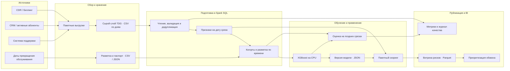

# Архитектура конвейера

Локальный прототип получает уже сформированные выгрузки TDG. `main.py train` выполняет этапы подготовки, разметки, обучения, оценки и публикации в нужном порядке. `main.py score` получает актуальный срез CRM, признаки и опубликованную модель. Контейнеризация описана в `Dockerfile`. Витрина готова для подключения к отчётности через Parquet.

Spark читает дневные CSV-партиции, проверяет кодировку, очищает и дедуплицирует записи, учитывает время поступления CDR и агрегирует события по абоненту и дате расчёта. В Python передаётся матрица признаков на уровне «абонент — дата» для обучения и скоринга XGBoost. Справочник абонентов и метки читаются отдельно.

По умолчанию Spark работает в локальном режиме `local[4]`. Для запуска на кластере требуется общее файловое хранилище для Spark-драйвера и исполнителей. Память драйвера при обучении зависит от размера матрицы признаков XGBoost.
